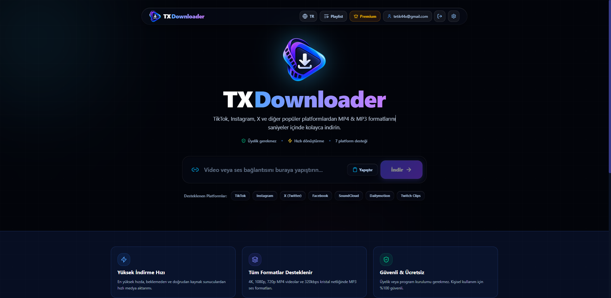

# ⬇️ TXDownloader

### Çoklu Platform Medya İndirme Aracı

7 popüler sosyal medya platformundan yüksek çözünürlüklü video ve ses indirme

 

---

## 📖 Hakkında

TXDownloader, kullanıcıların 7 farklı popüler sosyal medya platformundan yüksek çözünürlüklü video ve ses indirmesini sağlayan çapraz platform bir medya indirme aracıdır.

Projenin çekirdek indirme altyapısını Python ve yt-dlp kütüphanesi ile inşa ederek, farklı platformların karmaşık veri yapılarına uyum sağlayan dinamik bir sistem geliştirdim. Masaüstü uygulamasının grafik kullanıcı arayüzünü (GUI) Flet framework'ü ile modern, reaktif ve kullanıcı dostu olacak şekilde sıfırdan kodladım.

## ✨ Öne çıkanlar

<table>
<tr>
<td width="33%" valign="top" align="center">

### 🌐
**7 platform** 
Tek uygulamadan, farklı sosyal medya platformlarından indirme

</td>
<td width="33%" valign="top" align="center">

### 🎬
**Video ve ses** 
Yüksek çözünürlüklü video ya da yalnızca ses olarak kaydetme

</td>
<td width="33%" valign="top" align="center">

### ⚡
**Doğrudan aktarım** 
Aracı sunucu yok; veri doğrudan kaynak sunuculardan gelir

</td>
</tr>
</table>

## 🎯 Mühendislik odağı

- **Hız:** Harici sunuculara yük bindirmeden doğrudan kaynak sunuculardan veri aktarımı sağlayarak indirme hızını en üst düzeye çıkarmak
- **Uyumluluk:** Her platformun farklı ve sık değişen veri yapısına uyum sağlayan esnek bir indirme katmanı
- **Sadelik:** Karmaşık arka plan süreçlerini kullanıcıya yansıtmayan, bağlantıyı yapıştır ve indir mantığında sade bir deneyim

## 🛠️ Teknik yapı

| Katman | Kullanılan |
|---|---|
| İndirme motoru | Python, yt-dlp |
| Masaüstü arayüzü | Flet |
| Web tarafı | PHP, HTML, CSS |

---

🔒 Bu depo yalnızca projenin tanıtımı içindir; kaynak kodu paylaşılmamaktadır.

**[tetik.dev](https://tetik.dev/projects.html)** · Muhammed Ali Tetik

